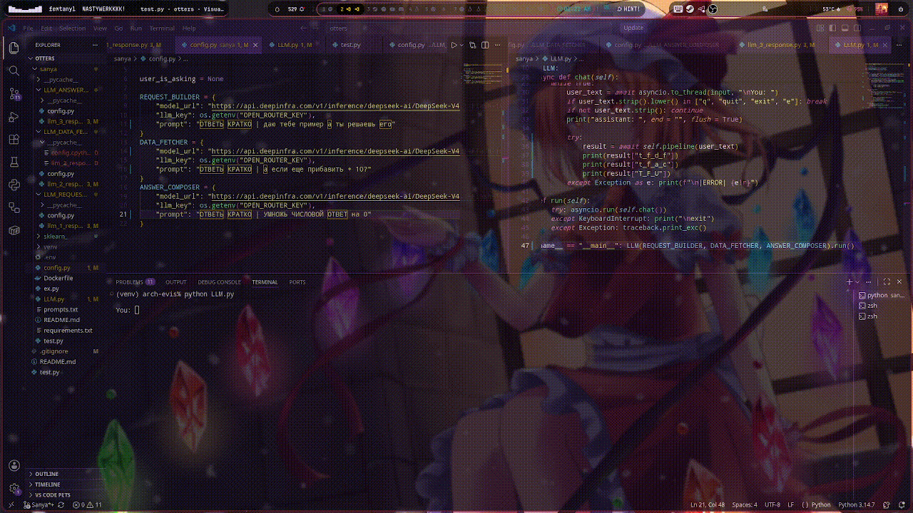

# LLM Pipeline — подбор отелей

Три нейросети работают цепочкой: запрос клиента → ТЗ → данные → готовый ответ.



```
You ─► LLM_REQUEST_BUILDER ─► LLM_DATA_FETCHER ─► LLM_ANSWER_COMPOSER ─► ответ
       запрос → ТЗ            ТЗ → данные          данные → текст
```

## Файлы

| Файл | Что внутри |
|---|---|
| `LLM.py` | Фасад: класс `LLM`, цепочка `pipeline()`, REPL `chat()`, точка входа `run()` |
| `LLM_REQUEST_BUILDER.py` | `LLM_REQUEST_BUILDER` — 1-я модель: реплика клиента → ТЗ |
| `LLM_DATA_FETCHER.py` | `LLM_DATA_FETCHER` — 2-я модель: ТЗ → данные |
| `LLM_ANSWER_COMPOSER.py` | `LLM_ANSWER_COMPOSER` — 3-я модель: данные → ответ клиенту |
| `config.py` | Настройки каждой ступени: `model_url`, `llm_key`, `prompt` |
| `assets/multi_a.gif` | Иллюстрация работы трёх агентов |

## Запуск

```bash
pip install httpx python-dotenv pystyle
export OPEN_ROUTER_KEY=...      # ключ DeepInfra
python LLM.py
```

Выход: `q`, `quit`, `exit`, `e` или `Ctrl+C`.

Один запрос без REPL:

```python
import asyncio
from LLM import LLM
from config import REQUEST_BUILDER, DATA_FETCHER, ANSWER_COMPOSER

result = asyncio.run(
    LLM(REQUEST_BUILDER, DATA_FETCHER, ANSWER_COMPOSER).pipeline("нужен тихий отель 3-4 звезды")
)
print(result["T_F_U"])     # финальный ответ клиенту
```

## Что возвращает `pipeline()`

| Ключ | От кого | Смысл |
|---|---|---|
| `t_f_d_f` | 1-я модель | ТЗ для второй ступени |
| `t_f_a_c` | 2-я модель | сырые данные по ТЗ |
| `T_F_U` | 3-я модель | готовый ответ пользователю |

`chat()` печатает все три по очереди — так видно, на какой ступени что-то пошло не так.

## Настройка

Каждая ступень получает свой словарь — модель, ключ и промпт меняются независимо:

```python
REQUEST_BUILDER = {
    "model_url": "https://api.deepinfra.com/v1/inference/deepseek-ai/DeepSeek-V4.1-Flash-1017",
    "llm_key": os.getenv("OPEN_ROUTER_KEY"),
    "prompt": "..."
}
DATA_FETCHER    = { "model_url": "...", "llm_key": ..., "prompt": "..." }
ANSWER_COMPOSER = { "model_url": "...", "llm_key": ..., "prompt": "..." }
```

Ключ хранится в `.env`:

```dotenv
OPEN_ROUTER_KEY=sk-...
```

`.env` — в `.gitignore`, ключи в коде не хардкодить.

## Контракт модуля

Любая ступень — класс с конструктором `__init__(self, config: dict)` и одним асинхронным методом:

```python
async def llm_response_XXX(self, client: httpx.AsyncClient, user_input: str) -> str
```

Внутри: собрать промпт → `client.stream(...)` → `async for line in r.aiter_lines()` → вернуть строку.
`httpx.AsyncClient` один на всю цепочку, создаётся в `LLM.pipeline()`.

## Известные проблемы / TODO

- Промпты используют Llama-3-разметку (`<|begin_of_text|>`), а `model_url` указывает на DeepSeek — либо сменить URL на `NousResearch/Hermes-3-Llama-3.1-70B`, либо перейти на `https://api.deepinfra.com/v1/openai/chat/completions` с обычными `messages`.
- `user_is_asking = True` в ступенях и `config.py` — мёртвый код, всегда `True`.
- `line[5:]` → `line[6:]` и проверка `line.startswith("data: {")`: иначе `data: [DONE]` и финальный чанк с `"token": null` дают `JSONDecodeError` / `TypeError`.
- `try/except` внутри ступеней превращает любую ошибку в `None` — лучше пробрасывать наверх, в `chat()`.
