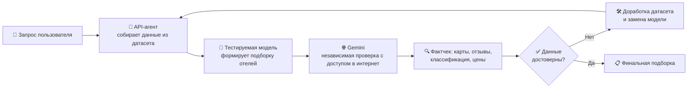

# 🏨 AI-Агент подбора отелей Москвы

> **От противоречивых ответов API-моделей — к быстрым локальным моделям и обогащённому датасету.**
> Подбор отелей по расположению, метро, ресторанам, магазинам и достопримечательностям рядом.

---

## 📌 О проекте

Проект решает задачу подбора отелей в Москве по запросу пользователя на естественном языке:

- 🚇 рядом с нужной станцией метро;
- 🍔 рядом с конкретными ресторанами и кафе — например, по запросу *«хочу в Ростикс»*;
- 🌳 рядом с парками, магазинами и достопримечательностями;
- 💰 с учётом цены, категории и формата размещения.

Главная проблема, с которой столкнулся проект: **нейросеть уверенно отвечала, но придумывала детали** — завышала звёздность, ошибалась в инфраструктуре и противоречила сама себе. Поэтому основной объём работы — не «заставить модель отвечать», а **научить её отвечать достоверно**.

---

## 🧪 Как тестировалась модель

Тестирование строилось как независимая проверка фактов, а не «нравится / не нравится ответ»:

**Что именно проверялось в каждом ответе:**

| Критерий проверки | Как проверялось |
|---|---|
| 📍 География | Расстояния до метро, ресторанов, магазинов — по картам |
| ⭐ Звёздность и формат | Официальная категория: отель / мини-отель / хостел |
| 💰 Цены | Соответствие реальному ценовому диапазону |
| 🏋️ Инфраструктура | Наличие спа, фитнеса, конференц-залов, общих санузлов |
| 🚇 Транспорт | Станции **и линии** метро, время пешком |
| ⚠️ Противоречия | Не спорит ли ответ сам с собой |

---

## 🔄 Эволюция моделей

### ❌ Итерация 1 — `XiaomiMiMo/MiMo-V2.6-Flash` (API)

Модель оказалась **противоречивой**. Характерные ошибки:

- В начале ответа: *«ни один отель не соответствует категории 5 звёзд рядом с метро»* — и тут же предлагает **StandArt (5★)** в 42 м от метро «Тверская».
- Про StandArt заявила: *«нет информации о фитнес-центре, спа и конференц-залах»*. На деле в отеле есть **Kinari SPA, хаммам, мини-бассейн, фитнес-зал и 2 конференц-зала**.
- Отель **«In Time»** выдала за **4★ за 7 547 ₽**, хотя это скромный **3★ мини-отель** за ~4 000–6 000 ₽ без лифта.

> **Вердикт проверки:** география посчитана правильно, но инфраструктура и класс отелей — выдуманы. Доверять нельзя.

### ⚠️ Итерация 2 — `zai-org/GLM-5.3` (API)

Выбрана за большой контекст (**до ~1048K**) и 4-битную квантизацию, снижающую потребление памяти и ускоряющую инференс. Стало лучше по географии, но ошибки остались критичными:

- Рекомендовала гостиницу **«Библиотека»** как «отель 2★», хотя это **хостел мансардного типа с общими санузлами**, а по актуальным данным карт объект **вообще закрыт**.
- Указала, что «Марксистская» — Таганско-Краснопресненская линия (на самом деле — **Калининская**).
- Нашла «парк в 89 метрах» посреди плотной застройки Таганки — на деле там лишь небольшой сквер.

> **Вывод:** модель отвечает, но **ей не хватает данных**. Дело не только в модели — дело в том, *что* ей передают.

### 💡 Ключевое решение — обогатить датасет

Вместо одних лишь названий столбцов в модель стали передавать **уникальные значения** признаков: названия станций метро, ресторанов, магазинов и достопримечательностей.

> Теперь запрос *«хочу в Ростикс»* работает как надо: модель находит это название среди уникальных значений и подбирает отели, рядом с которыми такой ресторан реально есть. И так — по всем данным.

### ✅ Итерация 3 — две локальные модели (финал)

- 🔁 **Обе API-модели заменены на 2 локальные** — ради скорости и точности; обе дополнительно затюнены.
- 🎯 Модель анализа даты и вопроса первого агента заменена: `zai-org/GLM-5.3` → **`NVIDIA-Nemotron-3.5-Super-VL`**.
- 📊 Датасет расширен новыми признаками: **имена метро, ресторанов, магазинов, достопримечательностей и расстояния до них**.
- ⚡ Принцип: *чем меньше у модели параметров — тем быстрее и легче она работает с простыми, чётко очерченными задачами.*

#### Пример финального ответа

> **«Комфорт-Москва»** — 4 401 ₽/ночь, **47 м до метро «Третьяковская»**, магазин «Salita» в 41 м, заведение «Parka» в 25 м, «Палаты в Овчинниках» в 386 м.

| Отель | Цена, ₽/ночь | Метро | До метро | Фишка |
|---|---:|---|---:|---|
| «Комфорт-Москва» | 4 401 | Третьяковская | 47 м | Максимальная близость к центру |
| «Netizen» | 6 916 | Римская | 62 м | Стильный гибрид-отель |
| «ГородОтель» | 5 870 | Киевская | 51 м | Прямо в здании Киевского вокзала |
| «Элитон» | 4 522 | Бауманская | 117 м | Историческое место |
| «Ларгус» | 3 964 | Марксистская | 96 м | Доступная цена |

> **Вердикт проверки:** вымышленных отелей нет — все объекты реально существуют, привязка к метро выполнена с высокой точностью, цены реалистичны.

---

## 🧭 Выводы

1. **Модель — не главная проблема, данные — главная.** Замена моделей без обогащения датасета ошибки не убрала.
2. **Уникальные значения признаков решают:** модель может искать по конкретным названиям (метро, рестораны, POI), а не угадывать.
3. **Локальные компактные модели быстрее** и на простых задачах дают ответы не хуже больших API-моделей.
4. **Независимый фактчек обязателен:** каждый ответ проверялся внешней моделью с интернетом и ручной сверкой с картами и отзывами.

### ⚠️ Известное ограничение

Главная оставшаяся манипуляция — **терминологическая**: под вывеской «отели 3★» модель всё ещё объединяет разные форматы — хостел с дормиториями («Netizen»), вокзальную гостиницу («ГородОтель») и мини-отели. Следующий шаг — явно передавать в датасет **тип объекта** (отель / мини-отель / хостел) и официальную классификацию, чтобы категория не «додумывалась».

---

## 📊 Сравнительная таблица: ДО → ПОСЛЕ

| Критерий | ❌ ДО — что отвечала нейросеть | ✅ ПОСЛЕ — как стало |
|---|---|---|
| **Модели** | 2 API-модели: `XiaomiMiMo/MiMo-V2.6-Flash`, затем `zai-org/GLM-5.3` | 2 **локальные** затюненные модели; анализатор запроса — `NVIDIA-Nemotron-3.5-Super-VL` |
| **Скорость** | Зависимость от API, медленные ответы больших моделей | Быстрый локальный инференс: компактные модели на простых задачах |
| **Что передаётся в модель** | Только названия столбцов датасета | Столбцы **+ уникальные значения**: метро, рестораны, магазины, достопримечательности |
| **Поиск по названиям** | Не умела: запрос «хочу в Ростикс» не давал результата | Находит отели рядом с конкретным заведением по его названию |
| **Существование отелей** | Рекомендовала **закрытую** гостиницу «Библиотека» | Все 5 отелей из подборки **реально существуют и работают** |
| **География и расстояния** | В целом верно, но «по прямой»: «парк в 89 м», «до дороги — 30 м» | Точные привязки: 47 м до «Третьяковской», 62 м до «Римской», 51 м до «Киевской» |
| **Линии метро** | Ошибка: «Марксистская» отнесена к фиолетовой ветке | Станции и расстояния указаны корректно |
| **Звёздность** | Грубое враньё: «In Time» — 4★ (реально 3★), хостел «Библиотека» — «отель 2★» | Категории ближе к реальности; остаточная проблема — мини-отели и хостел подписаны как «3★» |
| **Инфраструктура** | Выдумка наоборот: у StandArt «нет спа и фитнеса» (на деле — SPA, хаммам, бассейн, 2 конференц-зала) | Описывает только реальные объекты рядом: «Parka» в 25 м, «Salita» в 41 м, «Палаты в Овчинниках» в 386 м |
| **Цены** | Завышены: «In Time» — 7 547 ₽ при реальных ~4 000–6 000 ₽ | Реалистичный диапазон: 3 964–6 916 ₽/ночь, соответствует рынку |
| **Внутренние противоречия** | Да: «нет 5★ у метро» → тут же StandArt 5★ в 42 м от метро | Нет: подборка логична, текст не спорит сам с собой |
| **Вердикт независимой проверки (Gemini)** | «Подборка содержит грубые фактические ошибки, доверять на 100% нельзя» | «Практически не галлюцинирует: все отели реальны, география — с высокой точностью» |
| **Итог** | Уверенные ответы с выдуманными деталями | **Модель оптимизирована по скорости, датасет — по достоверности**; остался один шаг — явный тип объекта (отель/хостел/мини-отель) |
